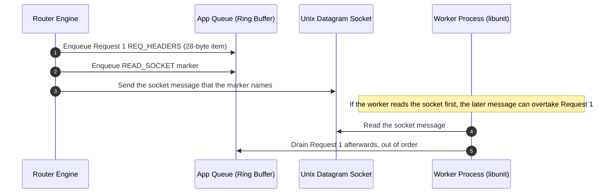
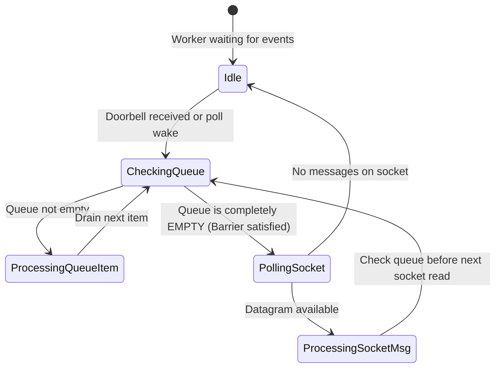

# Dual-Channel IPC & Invariants

A critical design characteristic of FreeUnit is its dual-channel IPC architecture between the router process and application workers. This document explains the operational dynamics, historical race conditions, and how `tools/model` checks message ordering.

---

## Channels Comparison

| Property | Application Queue (`nxt_app_queue_t`) | Unix Datagram Socket (`nxt_port_socket.c`) |
|---|---|---|
| **Underlying Mechanism** | Lockless circular ring buffer in shared memory | `AF_UNIX` datagram socket pair (`SOCK_DGRAM`) |
| **Descriptor Payload** | Maximum 31 bytes (`size` + `data[31]` + `tracking`) | Unbounded socket datagrams + ancillary `SCM_RIGHTS` |
| **Signaling** | Atomic `notified` flag and a `READ_QUEUE` port message | Socket readiness wake-up via `epoll` / `poll` |
| **Typical Use** | `REQ_HEADERS` dispatch: a 28-byte item (port msg + mmap msg). A failed send is HTTP 500. | Control messages, body/data after a `READ_SOCKET` marker in the queue, and `SHM_ACK` when `oosm` was set |

---

## Historical Race Condition: Message Inversion

Commit [`39700f29`](https://github.com/freeunitorg/freeunit/commit/39700f29) is the order fix in FreeUnit. https://github.com/freeunitorg/freeunit/pull/573 is a libunit WebSocket frame-order change. https://github.com/freeunitorg/freeunit/issues/597 is a tracking issue.

The server does not send `REQ_HEADERS` on the socket when a request is large. `REQ_HEADERS` always goes on the queue. Order between a queue item and a later socket message is kept by a `READ_SOCKET` marker placed in the queue. If the worker read the socket first, a later datagram could overtake an earlier queued item.

---

## The Solution: Queue Drain Barrier & Request FSM

To keep FIFO order across both channels, FreeUnit uses:
1. A `READ_SOCKET` marker in the queue, so the worker sees the queue item before the matching socket message.
2. A queue drain before a new socket read.

---

## Verification in `tools/model`

In `tools/model`, this ordering contract is checked by **`AdversarialInterleaver`** (`tools/model/analyzer/interleaver.py`) and validated by `tests/test_dual_channel.py`.

The test simulates:
- 5 sequential requests dispatched across both queue and socket channels.
- Randomized arrival delays injected into the socket channel.
- The invariant checker confirms that response stream IDs arrive at the client in strict monotonic sequence, checking that the modelled drain barrier keeps stream order in that scenario. The model does not yet model the `READ_SOCKET` marker.
