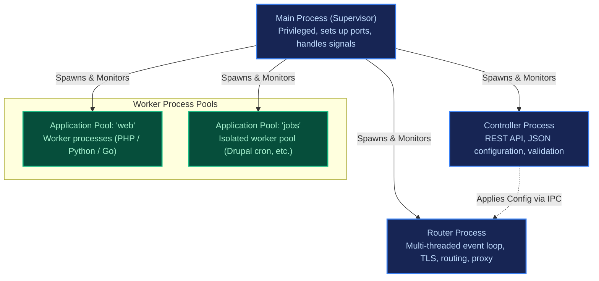
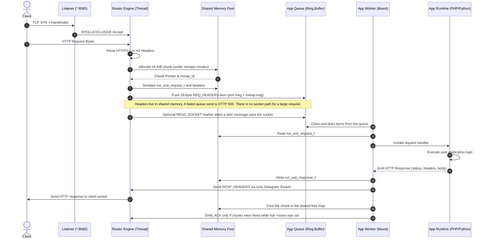

# FreeUnit Subsystem Architecture & Lifecycle

This document provides a detailed breakdown of FreeUnit's runtime architecture, data plane mechanics, and how each subsystem is modeled in `tools/model`.

---

## Process Topology

FreeUnit operates as a process hierarchy designed for fault tolerance and zero-downtime reconfiguration:

---

## Request Lifecycle Sequence

When an external client initiates an HTTP request, the data travels through the following sequence across threads and processes:

---

## Subsystem Details

### 1. Listener (`tools/model/engine/listener.py`)
- FreeUnit uses `EPOLLEXCLUSIVE` on Linux to avoid the thundering herd problem when multiple router threads wait on the listening socket.
- Connections are tracked via explicit state machines (`INIT`, `ACCEPTED`, `HANDSHAKE`, `READING`, `PROCESSING`, `SENDING`, `KEEPALIVE_IDLE`, `CLOSING`, `CLOSED`).
- Idle connections in keep-alive state are managed with connection-scoped tasks (`c->task`) and deferred release timers (`r->timer`), ensuring no dangling pointer dereferences occur when an application timeout fires.

### 2. Router Engine (`tools/model/engine/router.py`)
- Operates $N$ event engines (`nxt_event_engine_t`), each running a non-blocking event loop.
- Manages an RPC stream hash table (`RpcStream`), tracking in-flight requests from creation until client response completion.
- Dispatches `REQ_HEADERS` on the shared queue as a 28-byte item (`nxt_port_msg_t` 16 bytes plus `nxt_port_mmap_msg_t` 12 bytes). The headers themselves are in shared memory. A failed queue send is HTTP 500. The server has no socket fallback for a large request. The model still sends a 16-byte item and falls back to the socket; that difference is listed in [tools/model/README.md](../../../tools/model/README.md).

### 3. Shared Memory Pool (`tools/model/engine/shm_pool.py`)
- Request and response bodies are transferred via pre-allocated shared memory segments partitioned into 16 KiB chunks.
- Allocations are protected by `mmaps->mutex`.
- Implements Out-Of-Shared-Memory (OOSM) backpressure: a chunk is freed by setting its bit in the shared free map. `SHM_ACK` is sent only when chunks were freed while the header `oosm` flag was set, not on every release.

### 4. App Worker Runtime (`tools/model/engine/worker.py`)
- Built on `libunit` C client library.
- Workers poll both the private socket pair and the shared-memory queue ring buffer.
- Order between the queue and the socket is kept by a `READ_SOCKET` marker in the queue. The worker drains the queue, including that marker, before reading the matching socket message. The model does not yet model `READ_SOCKET`.
