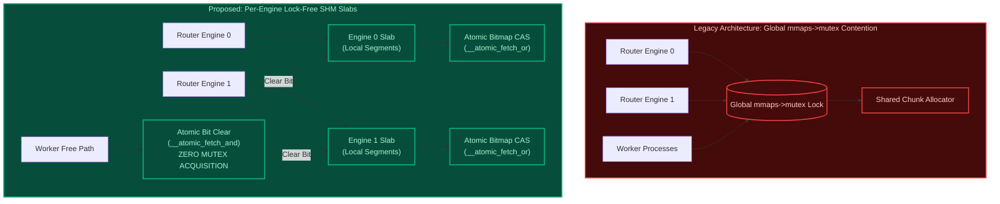

# Lock-Free Per-Engine Shared Memory Slabs

In FreeUnit, shared memory buffer allocation currently funnels through a global mutex in `src/nxt_port_memory.c` (`mmaps->mutex`). The `tools/model/synthesis/` module sketches a lock-free per-engine SHM slab as a proposal. It is not a measurement of a live server, and it is not in FreeUnit today.

---

## 1. Architectural Comparison



---

## 2. Modelled invariants

The check is of this model. Each slab takes a `threading.Lock` to emulate
an atomic bit update. A global mutex counter exists in the code but is
never incremented.

1. **Local allocate, remote free**: Chunks allocated on Engine $A$ and freed by Engine $B$ or Worker $W$ clear the corresponding bit in Slab $A$'s bitmap.
2. **Double-free detection**: Clearing an already unset bit raises an error.
3. **Conservation**: The number of active chunks equals allocations minus frees after the modelled run.

---

## 3. Simulation & Validation API (`LockFreeShmPool`)

```python
from tools.model.synthesis import LockFreeShmPool

pool = LockFreeShmPool(num_engines=4)

# Engine 0 allocates a 16 KiB chunk locally (zero locks)
chunk = pool.alloc(engine_id=0)

# Worker on Engine 2 frees the chunk remotely (zero locks)
pool.free(chunk, calling_engine_or_worker_id=2)

assert pool.verify_invariants() is True
stats = pool.get_stats()
assert stats["global_mutex_locks"] == 0
assert stats["active_chunks"] == 0
```
