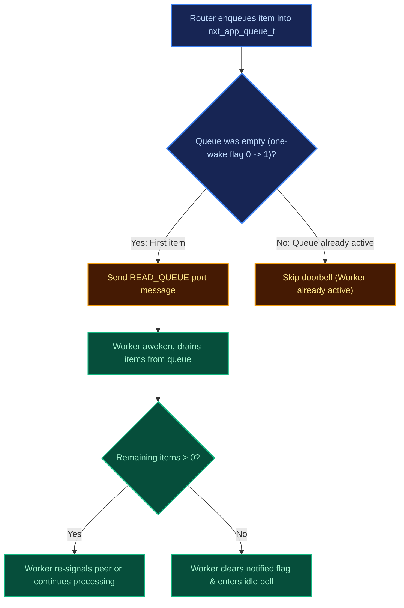
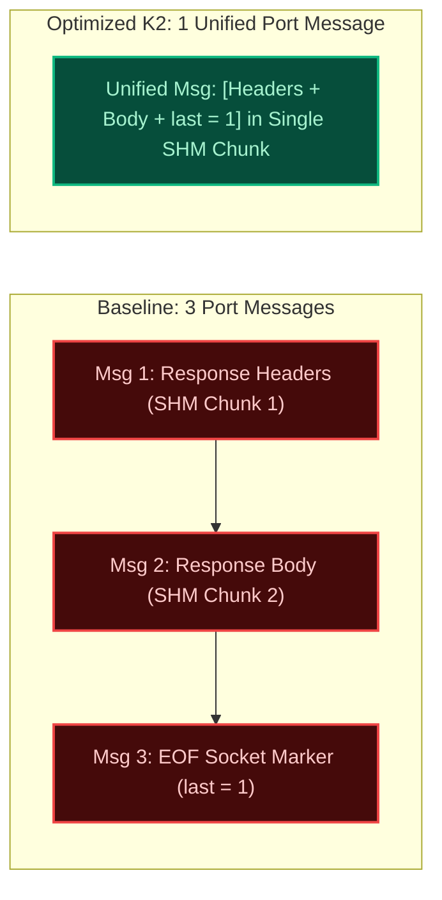
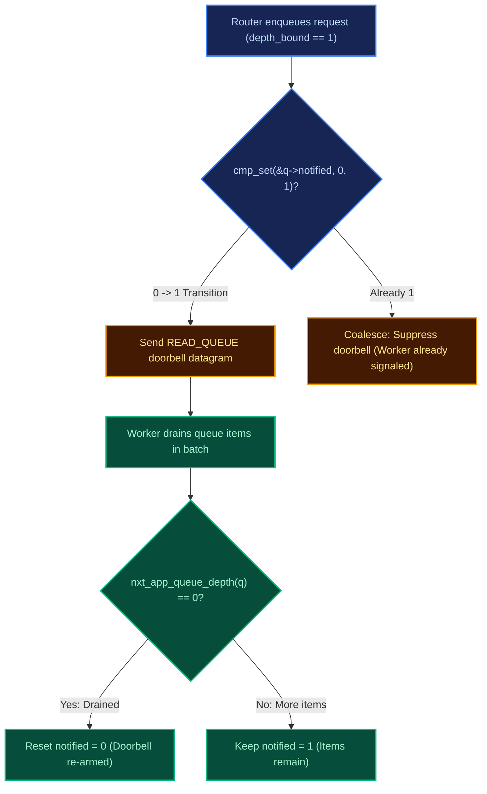

# Micro-Optimizations: K1 Doorbell & K2 Response Framing

`tools/model` can count modelled doorbells for two notify rules. Those counts are not context switches, syscalls, or CPU from a server run.

---

## K1: Single-Wake Doorbell (Herd Elimination)

### What the server does
`nxt_app_queue_t` has no `nitems` field. Notification uses
`nxt_app_queue_notify_decision(pos, depth_bound)` and a `READ_QUEUE` port
message. The one-wake flag and `depth_bound` are already in FreeUnit
1.37.2, so "every enqueue posts a doorbell" is not the baseline there.

### What the command counts
`python3 -m tools.model.cli benchmark-optimizations` counts modelled
notifications in two scenarios:

1. An artificial always-notify case, by clearing `notified` before every send.
2. The one-wake flag left set, so later enqueues in the same burst do not notify.

### Modelled counts
Run `python3 -m tools.model.cli benchmark-optimizations` from the harness root.
The numbers it prints are doorbell counts from that process. It does not
measure context switches or CPU.

---

## K2: Single-Buffer Response Framing (proposal)

K2 is a proposal that is not in the server. The piggyback body budget
used here (`PHP_RESPONSE_ROOM`, 8192 bytes) is a model-only constant.

### The Problem in Baseline Wire Protocol
FreeUnit responses traditionally require:
1. Message 1: `nxt_unit_response_t` containing HTTP headers allocated in shared memory.
2. Message 2: Response body chunk allocated in a separate shared memory chunk.
3. Message 3: A bare `last = 1` EOF completion message.
This incurs **3 separate port messages and 2 shared-memory allocations** for even trivial 200 OK responses.

### The proposed change
FreeUnit's wire protocol already defines a `piggyback_content` pointer and `piggyback_content_length` in `nxt_unit_response_s` (`src/nxt_unit_response.h`). The proposal is a configurable piggyback reserve (`buf_size + reserve`):
- Small responses ($\le 16$ KiB) are packed directly into the same shared-memory buffer immediately trailing the response headers.
- The router parses headers and body content in a single pass.

### Modelled counts
This command does not count K2 messages. Do not treat the figures above as a
measurement.

---

## Single-Worker Queue Notification Coalescing (Commit `edd1283ca`)

### The Problem with Uncoalesced Single-Worker Signals
In FreeUnit with a single worker process (`depth_bound = 1`), position-based notification checks signaled every request arriving after the queue was drained. The message of FreeUnit commit `edd1283ca` mentions a CPU saving on a PHP hello run. This command does not measure that.

### The Solution: 0->1 Flag Coalescing & Drain Re-arming
Commit `edd1283ca` re-introduced coalescing on the `q->notified` flag specifically when `depth_bound == 1`:
1. **Producer Side**: The router signals the application port only on the atomic `0 -> 1` transition of `q->notified`. Subsequent enqueues while `notified == 1` suppress the doorbell.
2. **Consumer Side & Re-arming**: `nxt_app_queue_recv()` re-arms the doorbell by resetting `notified = 0` whenever the queue depth reaches zero (`nxt_app_queue_depth(q) == 0`).
3. **Deadlock Immunity**: If a worker dequeues without reading the doorbell (e.g. already awake from a previous task or crash recovery), the flag is cleared as soon as the queue drains, preventing permanent queue stalls.

---

## Multi-engine epoll signalfd spurious wakeup classification (https://github.com/freeunitorg/freeunit/pull/776)

### Multi-Threaded signalfd Race
In multi-threaded FreeUnit router engines, `signalfd` is non-blocking (`O_NONBLOCK`). When a process-directed signal (`SIGCHLD`, `SIGHUP`) arrives:
- Epoll reports the descriptor readable across multiple engine threads.
- Thread 1 wins the race, reads 128 bytes (`struct signalfd_siginfo`), and consumes the signal.
- Thread 2 attempts `read()`, but the kernel signal queue is now empty, returning `n = -1` with `errno = EAGAIN`.

### The Fix (`14c69bbce`)
FreeUnit introduced `nxt_epoll_signalfd_eagain(n, err)` to explicitly classify `(n == -1 && err == NXT_EAGAIN)` as a benign spurious wakeup rather than an error:
- Erroneous reads (e.g. `EINTR` or short reads $< 128$ bytes) still log `nxt_alert()`.
- Spurious `EAGAIN` wakeups return immediately without false-positive alerts, keeping CI and production logs clean.
