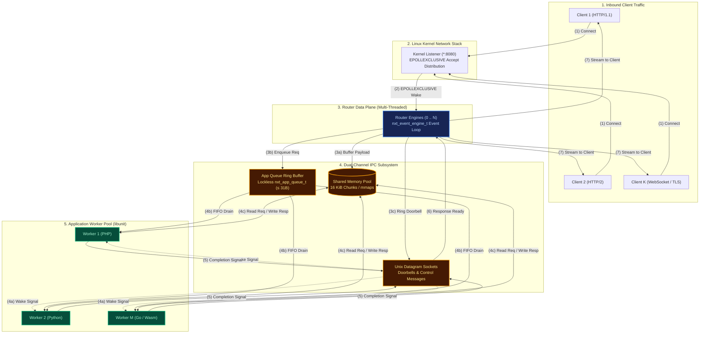

# FreeUnit discrete-event model

The Python package lives at [`tools/model`](../../tools/model/). Run commands from the harness root as `python3 -m tools.model.cli ...`. This is a behavioural model of [FreeUnit](https://github.com/freeunitorg/freeunit), not the server. A violation is a claim about the C code, to be traced in `src/` and reproduced with a test before anyone acts on it.

---

## High-Level System Architecture

FreeUnit processes HTTP traffic across decoupled process boundaries using a multi-threaded router and worker process pool communicating over a dual-channel IPC mechanism:



### End-to-End Request Lifecycle & Event Ordering

To resolve event ambiguity, the lifecycle sequence below illustrates the exact order in which a request flows across process boundaries:

```mermaid
sequenceDiagram
    autonumber
    actor Client as Inbound Client
    participant Listener as Kernel Listener (*:8080)
    participant Router as Router Engine (nxt_event_engine_t)
    participant SHM as Shared Memory Pool
    participant Queue as App Queue (Ring Buffer)
    participant Socket as Unix Datagram Socket
    participant Worker as Worker Process (libunit)

    Client->>Listener: 1. TCP Connection & TLS Handshake
    Listener->>Router: 2. EPOLLEXCLUSIVE Accept (single engine woken)
    Router->>SHM: 3a. Allocate Chunk & Store Request Body
    Router->>Queue: 3b. Enqueue Request Descriptor (<= 31B)
    Router->>Socket: 3c. Send READ_QUEUE Doorbell Datagram
    Socket-->>Worker: 4a. poll() wakes on Private Socket
    rect rgb(30, 41, 59)
        Note over Worker: Barrier: Drain Queue Before Socket Fallback
        Worker->>Queue: 4b. Dequeue Request Descriptor (FIFO order)
        Worker->>SHM: 4c. Read Request Payload
        Worker->>Worker: 4d. Execute Application SAPI Handler (PHP/Python/Go)
        Worker->>SHM: 4e. Write Response Body
    end
    Worker->>Socket: 5. Send Completion / Headers ACK
    Socket->>Router: 6. Response Ready Notification
    Router->>SHM: 7a. Read Response & Release Chunk
    Router->>Client: 7b. Stream Response Bytes to Client
```



---

## What `tools/model` Provides

The toolkit consists of two primary models and a C AST introspection engine:

```mermaid
graph LR
    subgraph Source["FreeUnit C Source"]
        CHeaders["src/*.h, src/*.c"]
    end

    subgraph AST["AST Schema Extractor"]
        TS["Tree-sitter C Parser"]
        CTypes["c_types.py<br/>(x86_64 ABI layout mirrors)"]
    end

    subgraph ModelA["Model A: Discrete-Event Simulation"]
        Clock["Deterministic Virtual Clock<br/>(SimEventLoop, priority queue)"]
        Engines["Router Engines &amp; Listener"]
        IPCSim["Dual-Channel IPC &amp; SHM Pool"]
        Frameworks["Framework Adapters<br/>(WordPress, Drupal, Laravel, Yii3)"]
    end

    subgraph ModelB["Model B: Adversarial Verification"]
        Interleaver["Adversarial Timing Interleaver<br/>(Permutes socket vs queue arrival)"]
        Chaos["Chaos Fault Injector<br/>(SIGKILL, OOSM, Client RST)"]
        Checker["Invariant Checker<br/>(INV-1 to INV-6 Core Invariants)"]
    end

    CHeaders --> TS --> CTypes
    CTypes --> ModelA
    ModelA --> ModelB

    classDef blue fill:#172554,stroke:#3b82f6,stroke-width:2px,color:#bfdbfe;
    classDef green fill:#064e3b,stroke:#10b981,stroke-width:2px,color:#a7f3d0;
    classDef yellow fill:#451a03,stroke:#f59e0b,stroke-width:2px,color:#fde68a;
    class CHeaders,TS,CTypes blue;
    class Clock,Engines,IPCSim,Frameworks green;
    class Interleaver,Chaos,Checker yellow;
```



1. **C AST schema and ctypes mirrors** (`c_types.py`, `ast_extractor.py`):
   tree-sitter extraction of structs from the headers, and a `schema` command
   that compares ctypes sizes and field offsets with that layout. It does not
   run a C compiler.
2. **Model A** (`tools.model.engine`): a deterministic discrete-event
   simulation of the router, workers, shared memory, and the two IPC channels.
3. **Model B** (`tools.model.analyzer`): an adversarial explorer that
   interleaves the two channels, injects faults, and checks six invariants.
   `verify --chaos --seed 1` currently exits 1 with two untraced violations.
   Treat those as leads, not findings. See [tools/model/README.md](../../tools/model/README.md).
4. **Doorbell counts in the model**: `benchmark-optimizations` counts modelled
   notifications. It does not measure context switches, syscalls, or CPU.

## Status

Known gaps, left for a later change, include the 28-byte `REQ_HEADERS` queue
item, the `READ_SOCKET` marker, and the claim/cancel window tracked in
https://github.com/freeunitorg/freeunit/issues/665. The model has no claim or
cancel step.

## Commands

```bash
python3 -m tools.model.cli simulate --requests 50 --workers 2
python3 -m tools.model.cli verify --chaos --seed 1
python3 -m tools.model.cli benchmark-optimizations
python3 -m pytest -q tools/model/tests
```

`schema` needs tree-sitter and a server checkout:

```bash
uv run --with tree-sitter --with tree-sitter-c python3 -m tools.model.cli schema --src ./src
```

## Navigation

- [System architecture](architecture/overview.md)
- [Dual-channel IPC](architecture/dual-channel-ipc.md)
- [C schema](architecture/c-schema.md)
- [Model A](models/model-a-simulation.md)
- [Model B](models/model-b-verification.md)
- [Doorbell counts](benchmarks/optimizations.md)
- [Conformance](verification/conformance.md)
- [Replay](verification/replay.md)
- [Request-path limits](verification/request-path-limits.md)
