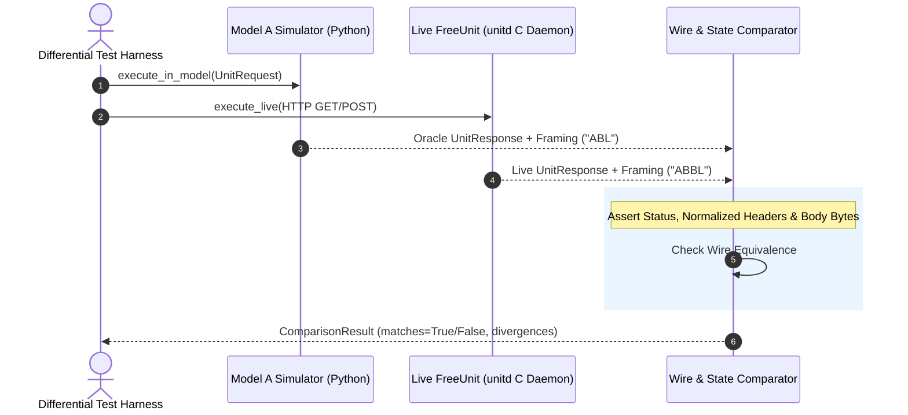

# Differential & Conformance Testing

`tools/model/conformance` can compare the model with a live `unitd` when you pass `--url`. Without `--url`, `python3 -m tools.model.cli conformance` is a self-check against the model's default handler. No server is compared.

---

## 1. Architecture Overview



---

## 2. Wire & Semantic Comparison (`WireComparator`)

The `WireComparator` validates:

1. **HTTP Status Code**: Strict integer equivalence.
2. **Normalized Header Fields**: Case-insensitive name folding, whitespace trimming, and multi-value concatenation while ignoring volatile headers (`Date`, `Server`, `X-Request-Id`, `Last-Modified`, `ETag`).
3. **Payload / Content Parity**: Exact byte-by-byte comparison of body contents.
4. **Framing Sequence Comparison**: Detects IPC framing differences, such as baseline double-buffer (`"ABBL"`) versus K2 single-buffer (`"ABL"`) execution paths.

```python
from tools.model.c_types import HttpHeaderField, UnitResponse
from tools.model.conformance import WireComparator

comparator = WireComparator()
res = comparator.compare_responses(oracle_resp, live_resp)
if not res.matches:
    print("Divergences detected:", res.divergences)
```

---

## 3. Tandem Session Runner (`TandemSession`)

`TandemSession` orchestrates dual execution across simulated and live backends:

```python
from tools.model.c_types import UnitRequest
from tools.model.conformance import TandemSession

session = TandemSession(target_url="http://127.0.0.1:8080")
req = UnitRequest(method="GET", path="/health")

# Run through both engines and verify exact wire equivalence
result = session.verify_equivalence(req)
assert result.matches is True
```
