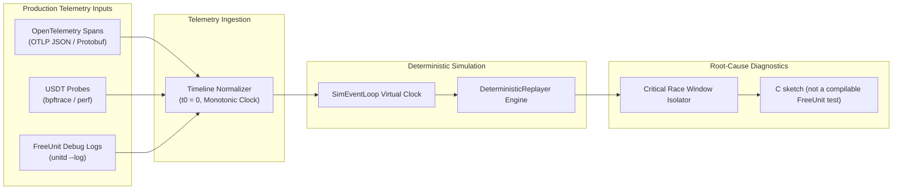

# Production Telemetry & Deterministic Trace Replay

The replay subsystem (`tools/model/replay/`) transforms real-world production telemetry into deterministic, reproducible discrete-event simulation runs, and can print a sketch of a C reproduction. That sketch is not a compilable FreeUnit test.

---

## 1. Pipeline Architecture



---

## 2. Ingestion Formats (`TelemetryIngestor`)

- **OpenTelemetry (OTLP)**: Ingests spans exported by `src/nxt_otel.c` and `src/otel/src/lib.rs`. The server exports `http.request.method`, `url.path`, and `http.response.status_code`, and no stream id. Replay uses the method and path; the status code is stored on the event.
- **USDT probes**: The provider names in FreeUnit are `port__recv`, `port__send`, `process__spawn`, `queue__cancel`, `queue__dequeue`, `queue__enqueue`, `queue__enqueue__fail`, `queue__no_doorbell`, `request__done`, `request__start`, and `test__probe`.
- **Debug Logs**: Extracts stream IDs, HTTP statuses, and sequential transitions from FreeUnit debug outputs.

---

## 3. Deterministic Replay (`DeterministicReplayer`)

Maps events onto the virtual clock.

```python
from tools.model.replay import TelemetryIngestor, DeterministicReplayer

ingestor = TelemetryIngestor()
events = ingestor.ingest_otlp_json(raw_spans_json)

replayer = DeterministicReplayer(num_engines=2, num_workers=4)
replayer.load_events(events)
summary = replayer.replay_all()

print(f"Replayed {summary.replayed_events} events, detected {len(summary.anomalies)} anomalies")
```

---

## 4. Root-Cause Analysis & C Litmus Synthesis (`RootCauseAnalyzer`)

Upon detecting an anomaly, the analyzer isolates the narrow temporal window ($\pm 20\,\mu\text{s}$) surrounding the event and synthesizes an C sketch case:

```python
from tools.model.replay import RootCauseAnalyzer

analyzer = RootCauseAnalyzer(summary, events)
critical_events = analyzer.isolate_critical_race_window()
c_test = analyzer.generate_c_litmus_test("nxt_race_repro_test", "dual_channel_inversion")
```
